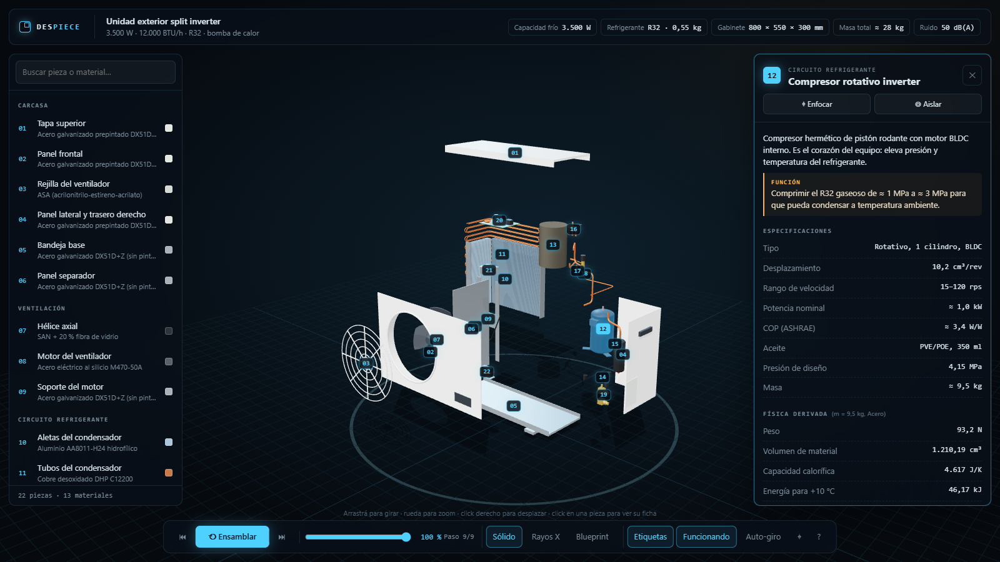
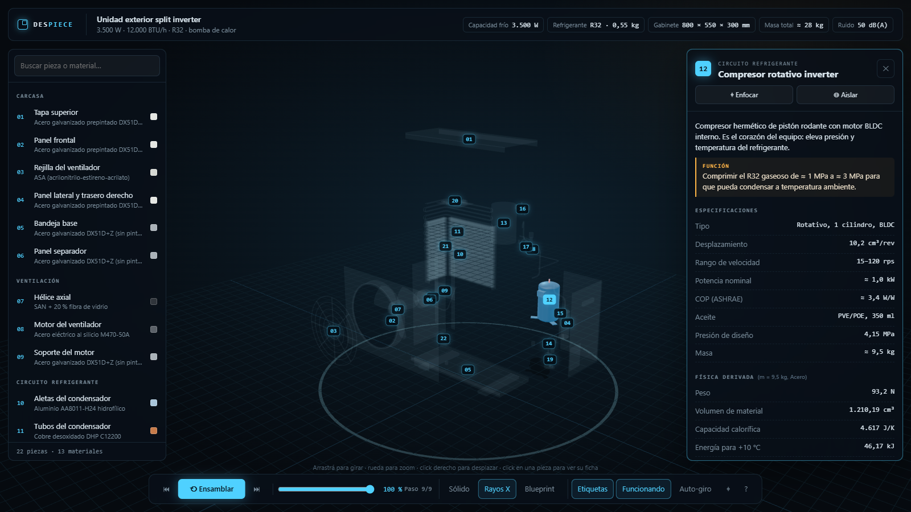

# Despiece

**Visor 3D interactivo de vistas explosionadas.** Girá un objeto, desarmalo pieza por pieza y tocá cualquier componente para ver de qué está hecho: material, propiedades físicas y especificaciones técnicas.

**▶ Probalo online: https://despiece-3d.vercel.app**



El ejemplo incluido es la **unidad exterior de un aire acondicionado split inverter** (3.500 W, refrigerante R32): 22 piezas y 13 materiales, desde el compresor hasta la placa de control.

## Qué podés hacer

- **Girar, acercar y desplazar** el objeto con el mouse o con los dedos.
- **Desarmarlo** de una vez, paso a paso o con el deslizador, en el orden en que se desarma de verdad.
- **Tocar una pieza** para abrir su ficha: descripción, función, especificaciones y física calculada (peso, volumen, energía para calentarla).
- **Ver cada material** con sus propiedades mecánicas, térmicas y eléctricas, la norma que lo define y barras para compararlo con el resto.
- **Cambiar la vista**: Sólido, Rayos X o Blueprint (plano de alambre).
- **Aislar o enfocar** una pieza, y **buscar** por nombre o material (por ejemplo, «cobre»).
- **Compartir una pieza**: cada ficha tiene su propio enlace, como `despiece-3d.vercel.app/#compresor`.
- **Simular el funcionamiento**: la hélice gira.
- Funciona en **celular**: la lista se abre con ☰ y la ficha sube desde abajo.



### Atajos de teclado

Pulsá `?` dentro de la aplicación para verlos.

| Tecla | Acción |
|---|---|
| `E` | Desarmar / armar |
| `←` `→` | Paso anterior / siguiente |
| `1` `2` `3` | Sólido / Rayos X / Blueprint |
| `F` | Enfocar la pieza seleccionada |
| `I` | Aislar la pieza seleccionada |
| `L` | Mostrar u ocultar etiquetas |
| `Espacio` | Simular funcionamiento |
| `R` | Giro automático |
| `0` | Restablecer cámara |
| `Esc` | Cerrar la ficha |

## Ejecutarlo en tu computadora

Necesitás [Node.js](https://nodejs.org) 18 o más reciente.

```bash
git clone https://github.com/facshot/despiece.git
cd despiece
npm install
npm run dev
```

Abrí http://localhost:5173 en el navegador.

Otros comandos:

```bash
npm run build         # versión optimizada en la carpeta dist/
npm run build:single  # un único archivo HTML en dist-single/, sin servidor
npm run preview       # sirve la versión de dist/
```

## Agregar tu propio objeto

El visor no depende del aire acondicionado: podés cargar un motor, una bicicleta, un mueble o cualquier producto.

1. Creá `src/models/<tu-objeto>/index.ts` y exportá un `ModelDef` (podés copiar el del aire acondicionado como base).
2. Describí cada pieza:

```ts
{
  id: 'disco-freno',
  name: 'Disco de freno',
  group: 'Frenos',                          // agrupa la lista lateral
  materials: [{ id: 'fundicion-gris' }],    // el primero es el principal
  description: 'Disco ventilado de fundición.',
  function: 'Convertir la energía del movimiento en calor.',
  specs: [{ label: 'Diámetro', value: 'Ø 280 mm' }, { label: 'Masa', value: '≈ 4,2 kg' }],
  explode: [0, 0, 0.4],                     // dirección y distancia de salida, en metros
  order: 2,                                 // etapa de desarme (0 sale primero)
  build: ({ mat }) => cyl(0.14, 0.022, [0, 0.3, 0], mat('fundicion-gris'), 'z'),
}
```

3. Si el material no existe, agregalo en `src/materials/library.ts`. Las unidades de cada propiedad están en `src/engine/types.ts`.
4. Registrá el modelo en `MODELS`, dentro de `src/main.ts`, y abrilo con `?model=<id>`.

Si una especificación se llama **Masa** y tiene un valor en kg, la sección «Física derivada» se calcula sola.

### Usar un modelo de CAD o Blender

Exportá el ensamble como `.glb` con un nodo por pieza, guardalo en `public/` y referencialo:

```ts
export const miModelo: ModelDef = {
  gltf: './mi-producto.glb',
  parts: [{ id: 'tapa', node: 'Tapa_superior', /* resto de la ficha */ }],
  // …
};
```

Cada nodo se toma por su nombre y recibe la explosión, la selección y la ficha. Los materiales del archivo se respetan.

## Estructura

```
src/
├── engine/          motor genérico: escena, explosión, selección, interfaz
├── materials/       biblioteca de materiales con propiedades físicas
├── models/          un archivo por objeto (el aire acondicionado está acá)
├── main.ts          punto de entrada
└── style.css
```

Hecho con [Three.js](https://threejs.org), TypeScript y Vite. Sin frameworks ni servidor.

## Sobre los datos

Las propiedades de los materiales son valores típicos de referencia a 20 °C según las normas citadas en cada ficha (EN, ASTM, JIS, IPC). Las especificaciones corresponden a un equipo genérico de su clase, no a una marca. Para trabajos de ingeniería, verificá con la ficha del proveedor.

## Licencia

[MIT](LICENSE)
